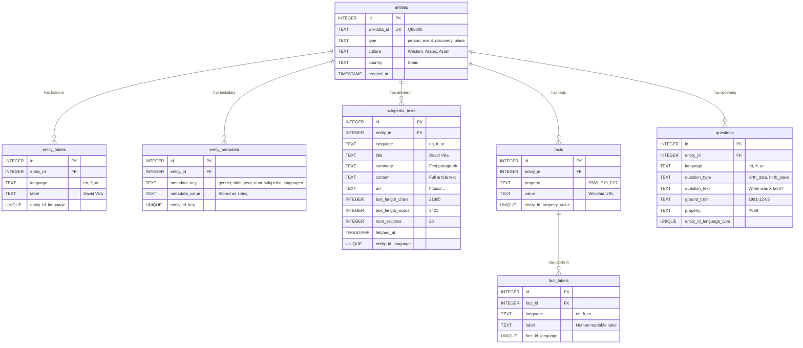

# Database Schema - Mermaid ER Diagram

## View this diagram:
- **Online**: Copy the code below and paste at https://mermaid.live/
- **VS Code**: Install "Markdown Preview Mermaid Support" extension
- **GitHub**: Just paste in README.md

---

## Entity-Relationship Diagram



---

## Quick Table Summary

| Table | Purpose | Key Columns | Multilingual? |
|-------|---------|-------------|---------------|
| **entities** | Core entity info | wikidata_id, type, culture | No (language-agnostic) |
| **entity_labels** | Entity names | entity_id, language, label | Yes (en/fr/ar) |
| **entity_metadata** | Flexible metadata | entity_id, key, value | No (uses keys) |
| **wikipedia_texts** | Wikipedia articles | entity_id, language, content | Yes (en/fr/ar) |
| **facts** | Wikidata properties | entity_id, property, value | No (URLs) |
| **fact_labels** | Fact labels | fact_id, language, label | Yes (en/fr/ar) |
| **questions** | Generated Q&A | entity_id, language, question | Yes (en/fr/ar) |

---

## Relationships Explained

### **One-to-Many Relationships:**

1. **entities → entity_labels** (1:N)
   - One entity has 3 labels (en, fr, ar)
   - Example: David Villa has "David Villa" (en), "David Villa" (fr), "دافيد فيا" (ar)

2. **entities → entity_metadata** (1:N)
   - One entity has multiple metadata key-value pairs
   - Example: David Villa has gender, birth_year, num_wikipedia_languages, etc.

3. **entities → wikipedia_texts** (1:N)
   - One entity has 0-3 Wikipedia articles (en, fr, ar)
   - Example: David Villa has 2 articles (fr, ar) - missing en

4. **entities → facts** (1:N)
   - One entity has multiple facts/properties
   - Example: David Villa has birth_date (P569), birth_place (P19), nationality (P27)

5. **facts → fact_labels** (1:N)
   - One fact has 3 labels (en, fr, ar)
   - Example: Birth place fact "Madrid" has labels in 3 languages

6. **entities → questions** (1:N)
   - One entity has multiple questions (3 types × 3 languages = 9 questions)
   - Example: David Villa will have 9 questions (birth_date, birth_place, nationality in en/fr/ar)

---

## Constraints & Indexes

### **Unique Constraints:**
- `entities.wikidata_id` - Each Wikidata ID appears once
- `entity_labels(entity_id, language)` - One label per language per entity
- `entity_metadata(entity_id, metadata_key)` - One value per key per entity
- `wikipedia_texts(entity_id, language)` - One article per language per entity
- `facts(entity_id, property, value)` - No duplicate facts
- `fact_labels(fact_id, language)` - One label per language per fact
- `questions(entity_id, language, question_type)` - One question per type per language

### **Indexes (for fast queries):**
- `idx_wikidata_id` on entities(wikidata_id)
- `idx_entity_type` on entities(type)
- `idx_culture` on entities(culture)
- `idx_entity_labels_lang` on entity_labels(language)
- `idx_wikipedia_texts_lang` on wikipedia_texts(language)
- `idx_fact_labels_lang` on fact_labels(language)
- `idx_entity_metadata_key` on entity_metadata(metadata_key)

---

## Data Flow Example

**For David Villa (Q83006):**

```
entities
└─ id=1, wikidata_id=Q83006, type=person, culture=Western

    ├─ entity_labels
    │   ├─ language=en, label="David Villa"
    │   ├─ language=fr, label="David Villa"
    │   └─ language=ar, label="دافيد فيا"
    │
    ├─ entity_metadata
    │   ├─ key=gender, value=Q6581097
    │   ├─ key=birth_year, value=1981
    │   ├─ key=num_wikipedia_languages, value=81
    │   └─ key=wikipedia_completeness, value=2
    │
    ├─ wikipedia_texts
    │   ├─ language=fr, title="David Villa", content=..., text_length_chars=21685
    │   └─ language=ar, title="دافيد فيا", content=..., text_length_chars=41118
    │
    ├─ facts
    │   ├─ property=P569, value="1981-12-03"
    │   ├─ property=P19, value=http://www.wikidata.org/entity/Q12345
    │   │   └─ fact_labels
    │   │       ├─ language=en, label="Tuilla"
    │   │       ├─ language=fr, label="Tuilla"
    │   │       └─ language=ar, label="توييا"
    │   │
    │   └─ property=P27, value=http://www.wikidata.org/entity/Q29
    │       └─ fact_labels
    │           ├─ language=en, label="Spain"
    │           ├─ language=fr, label="Espagne"
    │           └─ language=ar, label="إسبانيا"
    │
    └─ questions (future)
        ├─ language=en, type=birth_date, question="When was David Villa born?"
        ├─ language=fr, type=birth_date, question="Quand est né David Villa?"
        └─ language=ar, type=birth_date, question="متى ولد دافيد فيا؟"
```

---

## Usage Notes

### **Language-Agnostic Tables:**
- `entities` - Base info, no language
- `facts` - Wikidata URLs, no language
- `entity_metadata` - Key-value pairs, no language

### **Multilingual Tables:**
- `entity_labels` - Names in en/fr/ar
- `wikipedia_texts` - Articles in en/fr/ar
- `fact_labels` - Labels in en/fr/ar
- `questions` - Questions in en/fr/ar

### **Why This Design?**

1. **Efficient storage** - Don't duplicate base entity info 3 times
2. **Easy querying** - Join by language when needed
3. **Flexible** - Easy to add new languages
4. **Clean separation** - Language-agnostic data vs multilingual data